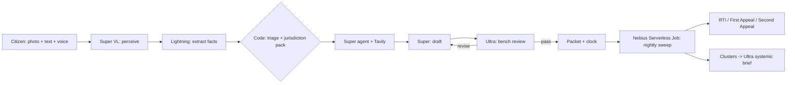

<div align="center">

# Nivaran &middot; निवारण

**File once. We keep the clock.**

*An agent that turns a photo and two sentences into a complaint the right office cannot ignore, then escalates by law when the government misses its own deadline.*

[Live demo](https://nivaran-indol.vercel.app) &middot; [Repo](https://github.com/harshkawatra11/nivaran) &middot; MIT License

Built with **NVIDIA Nemotron** (3.5 Lightning, 3.5 Super VL, 3 Super, 3 Ultra, 3 Nano) on **Nebius Token Factory**, a **Nebius Serverless Job**, a **Nebius Serverless Endpoint** (voice agent), **Tavily**, and Sarvam AI speech (STT/TTS only).

</div>

## The problem

Filing a civic complaint in India is easy. Getting an answer is the hard part. The Right to
Information Act, 2005 gives every citizen a legal 30-day answer window (section 7(1)), and
if it is missed the law treats it as an automatic refusal (section 7(2)) that can be
appealed within 30 days (section 19(1)), with a further 90-day window to the Information
Commission if that appeal is also ignored (section 19(3)). Almost nobody tracks these
windows by hand, so most citizens simply give up after the first unanswered complaint.

## What it does

1. **Report.** A photo and a few sentences, in Hindi or English, typed or spoken.
2. **Perceive.** Nemotron 3.5 Super VL reads the photo. Nemotron 3.5 Lightning extracts the
   structured facts.
3. **Decide (code).** The responsible office and the applicable service standard come from
   a versioned Delhi jurisdiction pack with sources, never a model guess.
4. **Research.** Nemotron 3 Super runs as a tool-calling agent, searching live with Tavily
   on official government domains only, to confirm the current grievance channel and find
   corroborating notices or news. Any link the agent did not actually fetch is dropped by
   code before it reaches the letter.
5. **Draft + Bench.** Super drafts the complaint; Nemotron 3 Ultra attacks it the way a
   reluctant officer would, looking for a reason to close it on a technicality. Super
   revises until Ultra passes it, up to three rounds.
6. **Clock.** The citizen files it and photographs the acknowledgement; Super VL reads the
   registration number and date; the statutory clock starts.
7. **Escalate.** A nightly sweep (Nebius Serverless Job, with a Vercel cron fallback)
   advances every overdue case through reminder &rarr; RTI (s.6) &rarr; First Appeal (s.19(1))
   &rarr; Second Appeal (s.19(3)), drafting each document automatically when its trigger
   deadline passes.
8. **Systemic.** Repeated failures in the same area are clustered by category and geohash;
   Nemotron 3 Ultra writes a systemic-failure brief and a collective representation a legal
   aid clinic can act on.
9. **Voice.** "Sahayak", a real-time Hindi/English voice agent (Sarvam STT/TTS plus
   Nemotron 3.5 Lightning for reasoning and tool calls), lets a citizen who cannot type
   file a report or ask "what happened to my complaint?" out loud.

## How we use NVIDIA Nemotron on Nebius Token Factory

| Model | Where it is used | Why this size |
|---|---|---|
| `nvidia/Nemotron-3_5-Lightning` | Intake field extraction, Hindi copies, the real-time voice agent | Fast and cheap enough for sub-second turns and streaming tool calls |
| `nvidia/Nemotron-3.5-Super-VL` | Reading photos, acknowledgement slips, and reply letters | The only tier with vision input |
| `nvidia/nemotron-3-super-120b-a12b` | The Tavily tool-calling research agent, drafting, and revisions | Reasoning strong enough for multi-step tool use, at a fraction of Ultra's cost |
| `nvidia/Nemotron-3-Ultra-550b-a55b` | Adversarial pre-filing review, reply-outcome judgment, systemic briefs | Reserved for the judgment calls that matter most |
| `nvidia/NVIDIA-Nemotron-3-Nano-30B-A3B` | Bulk per-case status digests in the nightly sweep | Cheapest tier for high-volume, low-stakes text |

Every call goes through one OpenAI-compatible endpoint
(`https://api.tokenfactory.nebius.com/v1`), so switching a stage between tiers is a one-line
change (`src/lib/llm/models.ts`). JSON-schema structured outputs, tool calling, and
automatic prompt caching all came for free with that one integration
(`src/lib/llm/client.ts`, `src/lib/llm/json.ts`, `src/lib/llm/agent.ts`). Per-call cost,
latency, and token counts are logged for every single request to an `llm_calls` table and
surfaced live on the `/how` page and inside every case's "Model ledger" drawer.

## The models propose. The code decides.

| Decided by an LLM | Decided by plain code |
|---|---|
| What the photo shows (`src/lib/pipeline/run.ts`, perceive stage) | Which authority is legally responsible (`src/lib/jurisdiction.ts`) |
| How to phrase the facts paragraph (`src/lib/llm/prompts.ts`, DRAFT_SYSTEM) | The statutory and policy deadlines (`src/lib/ladder/advance.ts`) |
| Whether a draft would survive a real officer's first read (bench review) | Which ladder step fires next, and when (`src/lib/ladder/advance.ts`) |
| How a government reply should be summarised for the citizen | Whether a reply counts as resolved, evasive, or a trigger for the next filing (`src/app/api/cases/[id]/reply/route.ts`) |
| Whether an RTI question is legally safe to file | The RTI question-legality linter itself, 18 deterministic rules ported from the author's earlier project Adhikaar (`src/lib/rti/linter.ts`, 100+ tests) |

## Nebius Serverless Job

`scripts/nightly.ts` (bundled by `scripts/build-job.mjs` into `dist-job/nightly.cjs`) runs
`runNightly()` from `src/lib/nightly.ts`: it sweeps every open case through the ladder,
writes Nemotron Nano digests for each transition, reclusters systemic failures, and
refreshes Nemotron Ultra briefs for clusters that grew. The same function is exposed as a
Vercel cron fallback at `/api/cron/nightly` so the escalation story works even before the
Nebius job is deployed. See `Dockerfile.job` and the deployment notes for the exact
`nebius ai job create` command.

## Evaluation

`npm run eval` (see `eval/`) scores category and authority routing accuracy, emergency
recall, and bench-review defect recall against a hand-written case set, and writes
`eval/RESULTS.md`.

## Architecture



## Run it locally

```bash
git clone https://github.com/harshkawatra11/nivaran && cd nivaran
npm install
cp .env.example .env.local   # fill NEBIUS_API_KEY, TAVILY_API_KEY, SUPABASE_URL, SUPABASE_SERVICE_ROLE_KEY
# run supabase/schema.sql in the Supabase SQL editor; create a private Storage bucket "evidence"
npm run spike     # checks every Nemotron model on your key, writes docs/SPIKE-RESULTS.md
npm run dev       # http://localhost:3000
npm run test      # deterministic core tests (117+)
npm run typecheck
npm run eval      # writes eval/RESULTS.md
npm run nightly   # one nightly sweep, locally

# voice agent (second terminal)
cd voice-service && python -m venv .venv && .venv/Scripts/activate  # or: source .venv/bin/activate
pip install -r requirements.txt && cp .env.example .env   # fill SARVAM_API_KEY, NEBIUS_API_KEY, VOICE_* secrets
uvicorn app.main:app --port 8080     # then open http://127.0.0.1:3000/voice
```

## Testing instructions for judges

No login is required; each browser gets its own private session.

1. Open the [live demo](https://nivaran-indol.vercel.app), click **Report a problem**, then
   **Try Meena's case** (or upload your own photo and text).
2. Watch the eight pipeline stages run live. Open **Model ledger** to see every Nemotron
   call and its cost.
3. Click **I've filed it**, then use the sample acknowledgement. Super VL reads the
   registration number and date; the clock starts.
4. Use **Time travel (demo)**, +30 days. The case goes overdue, and the reminder and RTI
   are drafted automatically.
5. Click **I filed the RTI**, then +30 days. The First Appeal is drafted.
6. Open **Ward board**, then a systemic cluster, to see the Ultra-written brief and the
   collective representation PDF.
7. Open **How it works** for the architecture, live per-model costs, and eval results.

## Built during the hackathon

New repository, created 25 Oct 2026 for the Nebius x NVIDIA Global AI Hackathon
(submission period 26 Aug &ndash; 30 Oct 2026). It reuses and adapts, with attribution, two
small deterministic utilities from the author's own earlier project Adhikaar: the RTI
question legality linter (18 rules) and the statutory deadline arithmetic pattern.
Everything else &mdash; the full Nemotron agent pipeline, Tavily research agent, adversarial
bench review, escalation ladder, nightly Nebius Serverless Job, systemic clustering, the
real-time voice agent, UI, and evaluation harness &mdash; was built for this submission.

## Feedback on Nebius Token Factory, AI Cloud, and NVIDIA tooling

See `docs/FEEDBACK-LOG.md` for the dated, specific notes collected while building this
(model ID casing in the catalog, structured-output behaviour per tier, reasoning-toggle
behaviour, Serverless Job/Endpoint setup on Windows, Tavily domain filtering). A condensed
version of this is also submitted as the hackathon's required feedback.

## Limitations

Delhi civic services only, for now. Legal and jurisdictional facts not yet re-verified
against a live source are marked "Source pending" in the UI rather than presented as
settled. Nivaran prepares filings; the citizen files them. This is not legal advice.

## License

MIT &copy; 2026 Harsh Kawatra. See [LICENSE](./LICENSE).
